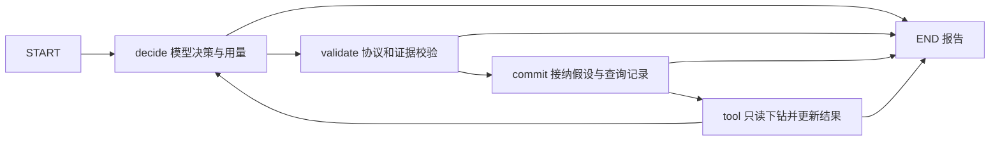

# 假设调查迁移到 LangGraph：第一阶段

异步 `hypotheses` 入口改由LangGraph控制多轮跳转，CLI和任务Worker不改变策略参数。报告策略标识为 `window_hypotheses_langgraph_v1`，旧 `investigate_hypotheses_legacy_async` 仅用于冻结的回归对照。固定规则、普通ReAct和同步评测入口继续保留，本次没有改变业务诊断规则或声称模型效果提高。

## 节点与领域逻辑



每个节点返回图状态增量，条件边在已有报告时结束。节点均为async函数，本地短操作仍同步执行；没有把整个手写循环包装进一个节点。`hypothesis_steps.py`包含共享的prepare/commit/execute阶段，图和旧执行器复用引用校验、候选账本、工具白名单和结论关联，没有复制第二套业务规则。

先验证整个动作，再接纳假设，再执行工具，保持已有语义。结束动作经过validate与commit后直接结束；重复查询在接纳前拒绝，随附假设不提交。图增加了调度边界，因此接纳后、执行前取消可能留下failed且cost_tool_calls=0的查询记录，表示未完成，不能当成已获取证据。校验与接纳都检查时限，迟到候选不生效。

模型次数和工具预算继续按业务账本约束，摘要占一次工具调用。LangGraph的recursion_limit设置为 `4 * max_tool_calls + 2`，只作框架保险，不把图节点数等同于工具次数。节点不配置自动重试，避免改变调用费用和失败语义。

## 状态与运行环境

图状态schema_version=1，包含绑定snapshot_id、证据、用量、假设历史、查询记录、轮次、原动作、待接纳候选和报告，使用字典/列表等数据类型；证据时间转JSON字符串。模型客户端、快照载荷和单调时钟留在本次独占运行环境，不进入图状态。节点从图状态重建领域对象，模型上下文依然深拷贝。

取消中的模型节点尚未返回图更新，但调用已实际发生；finally将用量写入本次运行环境，异常出口生成部分报告并继续抛InvestigationCancelled。取消不伪装成普通成功，也不把未知token记为零。框架远程追踪通过 `tracing_context(enabled=False)` 禁用，不能因环境变量继承而额外上传证据到LangSmith。

整个调查使用一个时间预算和累计token规则；预算创建于框架导入与快照读取前。冷导入、同步解析、清理等仍可能延迟取消返回。未完成模型调用可能继续在供应商侧计费。

**本阶段没有checkpointer或恢复入口。** JSON往返测试只证明数据边界，不证明安全导入任意外部状态、崩溃恢复或状态schema迁移。原始模型动作仅在本次内存图中流转，未来落库前须重新审查敏感数据保留策略。下一阶段还需设计：任务ID/图执行ID、Worker所有权与检查点写入隔离、时间与token跨恢复累计、未完成模型调用及工具结果的重放语义。不能直接打开PostgresSaver便宣称这些问题已经解决。

## 安装与运行

```powershell
.\.venv\Scripts\python.exe -m pip install -r requirements.txt -r requirements-graph.txt -r requirements-tasks.txt
.\.venv\Scripts\python.exe -m backend.investigation.window_cli investigate <snapshot_id> --strategy hypotheses
# 或通过任务API提交strategy=hypotheses，由现有Worker执行
.\.venv\Scripts\python.exe -m unittest discover -s tests -p test_hypothesis_graph.py -v
```

图依赖单独锁定在requirements-graph.txt，保留故障实验镜像的轻量基础依赖。使用LangGraph1.2.18、langchain-core1.7.1及安装报告中的传递依赖版本；pip check通过。LangGraph-checkpoint作为框架依赖存在，不代表已配置检查点。未引入LangChain模型适配器，仍使用现有DeepSeek适配器。

## 验证范围

2026-10-30：全量211项通过，无跳过，包含真实PostgreSQL任务/租约/SSE回归；新增5项图专项包含七组行为对照。pip check无依赖冲突。本次首次策略标识断言仍期待旧名称而失败，更新为新标识后复验通过。

新增测试比较成功、非法Schema、非法结论关联、重复查询、工具预算耗尽、模型错误、未知token等七组新旧报告；只规范化耗时、策略名及随机证据标识，领域结论和用量须相同。另检查真实节点顺序、图状态JSON往返、校验后接纳前取消、并发隔离和超过默认25图步数的合法预算执行。既有取消、迟到动作、预算及CLI测试继续走新的默认图入口。

由于旧执行器共享领域函数，新旧对照主要验证编排差异，不能代替既有领域单元测试和独立audit_history检查。未调用真实模型或重跑故障环境，测试不证明诊断准确率改善。真实模型对照需要另外冻结新协议和留出样本。

接口核对来源：[Graph API](https://docs.langchain.com/oss/python/langgraph/graph-api)、[持久化边界](https://docs.langchain.com/oss/python/langgraph/persistence)、[中断重执行语义](https://docs.langchain.com/oss/python/langgraph/interrupts)；本地核对安装版本的StateGraph和tracing_context签名。框架提供节点调度，领域校验、预算和评测由本项目实现；没有复制外部源码。

后续：Worker 已接入串行图数据库检查点，第一阶段的无持久化边界已由 [恢复阶段记录](021-graph-recovery.md) 补充；独立 CLI 仍不持久化。
