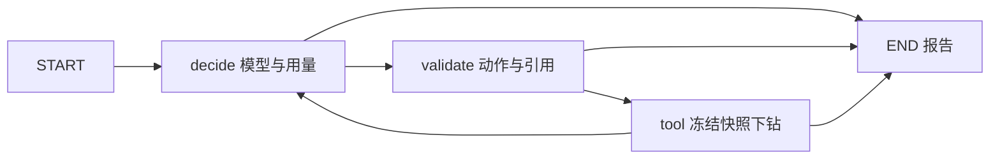

# 普通 agent 的串行图与恢复

日期：2026-10-31。实现范围对应 [022迁移计划](022-langgraph-agent-plan.md)：普通窗口 `agent` 的正式异步主循环由 LangGraph 控制，CLI 不持久化，Worker 配置租约检查点。请求策略名仍为 `agent`，报告标识为 `window_react_langgraph_v1`。

## 编排与领域边界



`window_graph.py` 定义三个节点与条件边；结束动作在校验节点生成报告，无需额外模型或结束节点。`window_investigation.py` 的 `prepare_window_action` 校验动作、引用、预算、快照范围与重复查询，`execute_window_action` 执行只读下钻并再次检查时间/工具预算。`apply_window_action` 保留兼容组合，同步执行循环没有迁移。

普通与假设策略共用 `graph_runtime.py` 的模型请求、用量、预算、状态恢复和取消出口；假设图仍保留原四节点及假设领域模块。状态保存版本、快照ID、证据、用量、轮次、原始动作、已校验动作和报告；普通状态不引入假设账本。客户端、连接和单调时钟不落库。图的递归上限随业务预算伸缩，不能用节点数代替工具调用次数。

`investigate_window_async` 是 CLI 的公共图入口；Worker 通过持久化执行器调用相同 `WindowGraphRun`。旧 `investigate_window_legacy_async` 只作测试对照，正式分发不再调用它。固定规则、同步普通窗口和旧单 Trace 入口继续保留；没有新增多 Agent、并行分支或审批。

## 持久化与升级

复用 [021恢复契约](021-graph-recovery.md)。`LeaseCheckpointSaver` 根据任务策略选择 `agent-graph-v1` 或既有 `hypotheses-graph-v1`，请求摘要和协议不一致时拒绝恢复。无新增数据库表或schema版本：已有schema 4可继续使用；旧环境仍需停止API/Worker后执行 `python -m backend.tasks init`。部署时停止旧Worker，避免旧普通执行器与新图混用。历史普通任务没有检查点，首次进入新执行器时建立新的执行预算，不能还原迁移前的调用历史。

已提交步骤恢复后不再调用同一轮模型；未确认调用返回 `usage_unavailable` 并停止自动重发。工具执行后未落库可重放只读冻结查询；最终报告检查点已提交时直接补交任务终态。恢复会用已提交的证据/用量替换新session初始化数据，因此摘要只计入一次。绝对截止时间含停机；租约和最终结果落库仍由任务层负责，旧令牌不能提交检查点或任务结果。

只在配置checkpointer时传入 `durability="sync"`。数据库错误传播给Worker，不在模型节点自动重试。未知调用不等于零用量，外部请求与数据库不能原子提交，不承诺 exactly-once。当前不保存并行pending writes，不支持子图、人工状态编辑或处置副作用；检查点清理、跨主机快照复制仍未实现。

## 取消与迁移中发现的问题

模型所在节点自行取消时，LangGraph 1.2.18会将其包装为 `NodeCancelledError`，与父任务取消不同。首轮CLI取消测试暴露该差异，共享运行出口现在将两种取消都转换为带部分报告的 `InvestigationCancelled`，保留已发生的调用和未知用量。

原普通超时测试要求两轮执行在50ms内进入等待；图调度后该前提不稳定。测试改为确认第二轮已进入，再通过真实 `asyncio.Timeout.reschedule` 触发截止。实际HTTP停流测试继续覆盖总时限与连接关闭；未放宽生产时限。同步读取、解析和清理仍可能让返回晚于截止时间，本地取消也不证明供应商停止计费。

## 运行与验收

```powershell
.\.venv\Scripts\python.exe -m pip install -r requirements.txt -r requirements-graph.txt -r requirements-tasks.txt
.\.venv\Scripts\python.exe -m backend.investigation.window_cli investigate <snapshot_id> --strategy agent
.\.venv\Scripts\python.exe -m unittest discover -s tests -p test_window_graph.py -v
# 设置专用 TASK_TEST_DATABASE_URL 后执行，测试使用随机schema并清理
.\.venv\Scripts\python.exe -m unittest discover -s tests -p test_graph_recovery.py -v
```

沿用锁定的LangGraph 1.2.18、langgraph-checkpoint 4.3.1；核对本地 `StateGraph.compile` 签名和 `NodeCancelledError`，未升级依赖或复制外部源码。框架负责调度/检查点格式，本项目负责领域规则、租约隔离、预算和独立验证。

普通图专项覆盖12组新旧报告对照、真实节点顺序及JSON往返、校验后取消/超时、长循环、并发隔离、CLI无检查点与Worker持久化分发。恢复专项同时执行假设与普通策略，使用真实PostgreSQL和子进程 `os._exit`，模型为替身；覆盖未知请求、工具重放、累计调用/token、截止时间、终态补交、旧租约回滚及协议/请求绑定。SQL提前过期租约不代表测量真实接管延迟。

另以提交 `7c786c4` 的旧假设图代码在子进程写入检查点并退出，再用本次共享运行模块恢复，完成且仅新增剩余的一次模型调用。这是一个已提交工具前边界的升级烟测，不代表任意历史状态迁移。

新旧对照共享领域函数，主要验证编排语义，领域正确性还依靠原测试和独立断言。本次没有真实模型调用或新故障环境评测，不声明诊断质量提升。

最终验证：全量238项通过，无跳过；普通图专项7项、普通异步专项13项、数据库恢复专项20项（原假设8项、普通12项）通过，`pip check` 无依赖冲突。全量包含任务/API/租约/SSE回归。本次未迁移默认业务schema，测试仅创建并清理随机schema。
