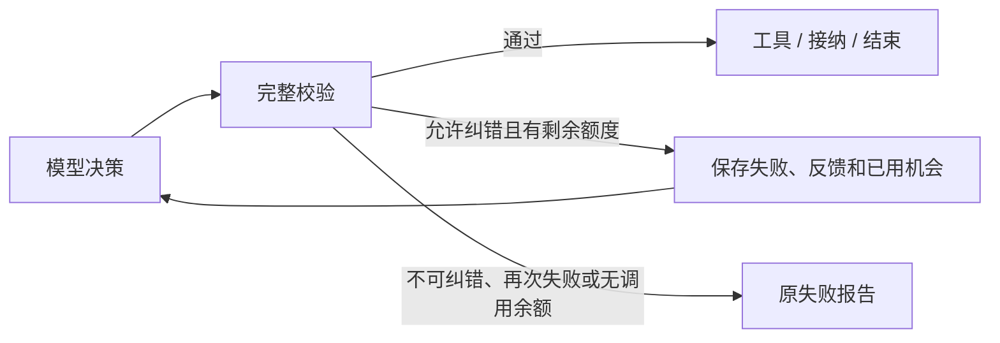

# 预算内一次协议纠错

日期：2026-11-03。范围：两种正式异步窗口策略 `agent` / `hypotheses`，CLI和持久化Worker共用图流程。默认关闭，不改变同步兼容入口或冻结旧循环。

## 使用与范围

```powershell
.\.venv\Scripts\python.exe -m backend.investigation.window_cli investigate <snapshot_id> --strategy agent --max-corrections 1
.\.venv\Scripts\python.exe -m backend.tasks submit <snapshot_id> --strategy hypotheses --max-corrections 1 --idempotency-key <key>
```

HTTP任务请求支持 `"max_corrections": 1`。参数只能为整数0或1，默认0；固定规则拒绝开启纠错。Python异步公共入口同样接收 `max_corrections`。对照时保持模型、快照、总调用数、token和时限相同，仅改变此开关。

首版只对校验阶段的 `action_schema`、`evidence_reference`、`hypothesis_link` 失败提供纠错机会。假设状态错误、工具范围错误、解析失败、网络/供应商错误、截断、未知用量、重复查询及预算终止不触发纠错。诊断是否正确仍由独立评测判断，执行器不接收真值。

## 执行与预算



反馈与机会计数在validate节点的状态更新中产生，条件边直接回到decide；没有把模型节点设为自动重试。每次调查最多一次机会，而非每轮一次。原失败动作不执行工具，也不接纳其候选假设；修正动作仍经过完整校验。

纠错请求占原模型调用次数、累计token及总时间预算，不增加额外额度。模型调用上限目前与 `max_tool_calls` 同值，工具预算仍包含摘要。最后一轮校验失败时直接保留原失败，不突破调用上限；纠错响应使token达到阈值时停止且不执行该动作。超时和取消保留已有证据、失败记录和用量。

## 反馈与报告

仅纠错请求的模型上下文含 `correction_feedback`，普通请求不增加空反馈字段。反馈包括失败轮次/固定原因码、固定修正规则、最多24个Schema错误路径，以及可安全保留的候选数据。字段路径只允许本地动作Schema中的字段名，未知字段名用 `<unknown>` 表示；不回显任意原始Schema失败动作。证据/关联失败时可携带已经通过结构校验的拒绝候选；候选序列化超过16KiB时省略。

候选文字是待修正数据，不能扩大工具权限；模型仍只能引用已经取得的观测，不获得隐藏证据或正确答案。反馈在下一次调用后清除，后续正常轮次不重复注入。模型实际请求载荷仍受现有上下文大小限制。

开启时最终报告包含 `correction = {limit, used, failures}`；关闭时为null。`used` 表示已经安排并消耗的纠错机会，可能因取消/崩溃而没有完成对应请求，不等于成功次数；实际调用与用量以 `usage` 为准。`failures` 保留校验失败的诊断和反馈，包括纠错再次校验失败；纠错请求本身发生网络/解析错误时由最终 `diagnostic` 和调用账本记录。成功不会抹掉先前失败，不自动将“协议修复成功”计为“诊断正确”。

## 检查点、租约与旧任务

开启纠错的图使用状态schema 2和独立协议 `agent-graph-correction-v1` / `hypotheses-graph-correction-v1`，保存已用机会、失败历史和待反馈。数据库仍为schema 4，无新增表。完整步骤同步提交后才请求模型：

| 中断边界 | 恢复语义 |
| --- | --- |
| 反馈与机会已提交，请求尚未登记 | 保持used=1，发送一次待处理纠错请求 |
| 纠错调用已登记，响应或结果未可靠落库 | `usage_unavailable`，不自动重发，也不退还机会 |
| 修正动作已提交，工具尚未执行 | 继续校验/工具步骤，不再请求该次修正 |
| 成功或失败终态报告已提交，任务终态未提交 | 补交任务结果，不再调用模型 |
| 重启期间到期或失去租约 | 延续原超时/租约隔离规则，不刷新预算 |

关闭纠错继续使用原v1协议，缺少新增状态字段的旧检查点按零机会和无反馈读取；旧终态报告没有纠错历史，不追溯补造。请求参数和协议仍绑定检查点，不允许将旧任务改成开启纠错后续跑。任务请求默认新增字段会改变幂等摘要，因此落库规范payload在值为0时省略 `max_corrections`，保留旧payload/hash；值为1时明确写入，同一幂等键改变开关会冲突。

部署先停止旧Worker再启动新版本，避免旧程序领取带新字段的任务。无需为已是schema 4的环境新增迁移；不要将纠错开启状态交给旧程序。串行完整步骤、只读工具重放、未知请求保守停止和租约有效性校验继续沿用现有边界，不承诺外部模型请求exactly-once。

## 验证与后续

专项覆盖一次成功、再次失败、关闭/最后轮次、token上限、取消/超时、反馈脱敏、引用修正与假设候选不污染、真实HTTPX替身请求载荷、CLI及HTTP任务参数校验。真实PostgreSQL测试对两种策略执行子进程强退，覆盖待反馈、调用中、响应已到但未提交、动作已提交、终态补交、跨重启预算、协议和历史幂等摘要。

另使用提交 `c0ff4cc` 的旧图运行模块与检查点执行器在子进程生成v1检查点，再用当前两种默认策略恢复；都完成且只新增剩余的一次模型请求。这是已提交工具前边界的升级烟测，不保证任意版本状态迁移。测试通过SQL提前过期租约，不测实际接管延迟。

没有新增依赖或复制外部代码；本地核对了已安装Pydantic的 `Field(exclude_if=...)` 支持。未调用真实模型或采集新故障样本，不声明降低协议失败率或提高诊断准确率。下一步应固定新样本与预算，比较纠错开关的诊断正确率、协议失败率、拒答与成本，保留所有失败。

最终验收：全量264项测试通过，无跳过，123.251秒；新增11项纠错专项、6项真实数据库恢复测试和1项HTTP参数测试。`pip check` 无依赖冲突，两种策略的旧v1检查点升级烟测通过。测试只创建并清理随机schema，未迁移默认业务schema。
